<picture>
  <source media="(prefers-color-scheme: dark)" srcset="assets/hero-dark.svg">
  
</picture>

Tech entrepreneur and systems architect. AI enthusiast. 
18+ years building production platforms.

## How I work

- **Start with intent.** Written specs and acceptance criteria come first.
- **AI accelerates, I decide.** I use AI to move faster. I stay accountable for every decision.
- **Quality is a gate, not a hope.** Tests, reviews and delivery discipline before anything ships.
- **Stay after launch.** Architecture is only half the work. The rest is making it run, and keeping it running.

<a href="https://www.linkedin.com/in/marouanomezzine/"><b>LinkedIn</b></a>
&nbsp;·&nbsp;
<a href="https://x.com/marouan"><b>X @marouan</b></a>
&nbsp;·&nbsp;
<a href="https://pixelium.tech"><b>Website</b></a>

